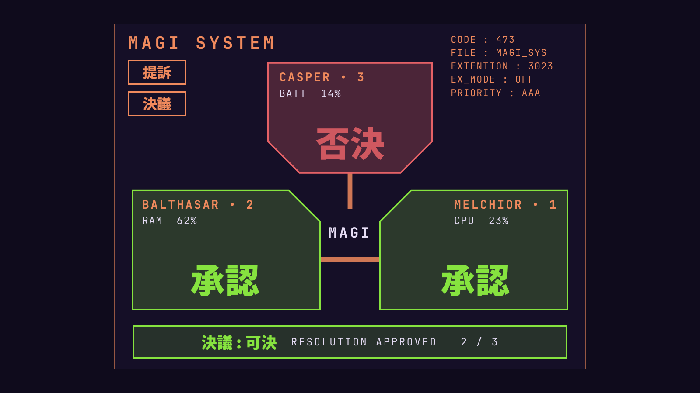

# MAGI — Omarchy desktop widget

The MAGI supercomputers from *Neon Genesis Evangelion*, deliberating over your
system on the desktop.



| Computer | Watches | Votes 承認 (approve) when… |
|---|---|---|
| **MELCHIOR • 1** | CPU | below 85 % |
| **BALTHASAR • 2** | RAM | below 90 % |
| **CASPER • 3** | Battery | 20 % or more, or charging |

A computer that votes **否決** (deny) turns coral and pulses. The resolution is
decided by majority, like the real MAGI: two votes or more and the banner reads
**決議 : 可決**, otherwise **否決**.

It is a `service` plugin that draws one transparent, click-through window on
the `bottom` layer — above the wallpaper, below your windows — so it shows on
empty workspaces. Stats are read from `/proc` and `/sys` every 2 seconds; no
extra packages, no bar widget.

## Install

```sh
omarchy plugin add https://github.com/remulef/omarchy-magi-evangelion.git --enable
```

Japanese text uses **Noto Sans CJK JP** (shipped with Omarchy's `noto-fonts-cjk`).

## Customize

- Position: `margins { top; left }` in `Service.qml`.
- Thresholds: `cpuOk`, `ramOk`, `batteryOk` in `Service.qml`.
- Colors: the palette at the top of `MagiView.qml` / `MagiPanel.qml`
  (EVA-01 lime `#86E33F`, coral `#E46166`, NERV orange `#F08A5D`).

## Remove

```sh
omarchy plugin remove fab.magi
```

Fan project, not affiliated with Khara or Gainax. Evangelion and MAGI belong to
their respective owners.
